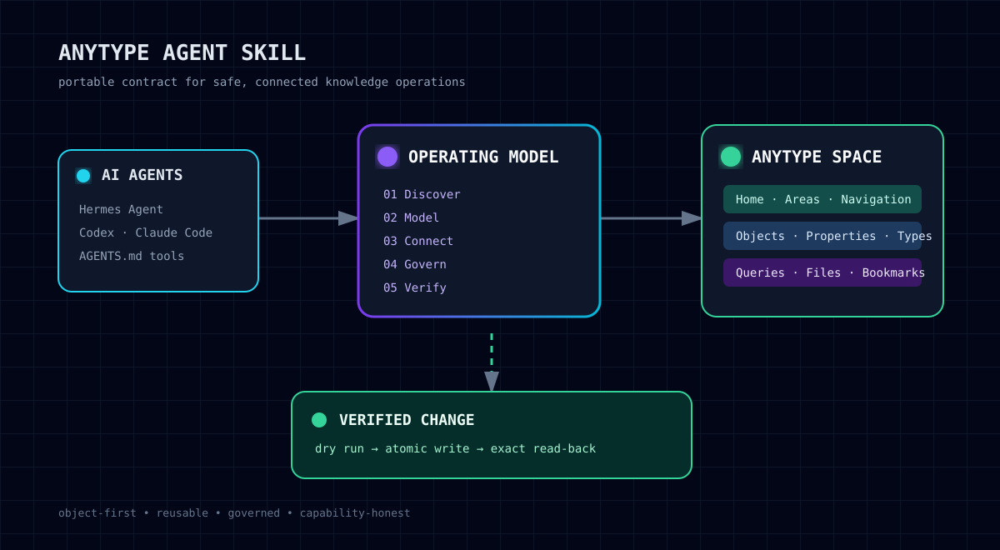

<div align="center">

# 🧠 Anytype Agent Skill

### A production operating model for AI agents that build reliable Anytype knowledge spaces.

[](RELEASE_POLICY.md)
[](https://anytype.io)
[](adapters/)
[](tests/test_portability.py)

An AI agent can create pages quickly. The hard part is creating a **connected, readable, governable knowledge system** instead of a pile of pages, files, duplicate links, and inconsistent tags.

[The problem](#the-problem) · [How it works](#how-it-works) · [What's new](#whats-new-in-v110) · [Agent adapters](#agent-adapters) · [Capabilities](#capabilities) · [Safety](#safety-boundaries)

---

</div>

<p align="center">
  
</p>

## The problem

Most Anytype automation fails in predictable ways:

- it imports content into the root instead of a navigable information architecture;
- it creates plain URLs instead of native Object cards;
- it treats Pages, Types, Properties, Queries, and Collections as interchangeable;
- it copies the same file or Object instead of reusing it;
- it buries dates, statuses, and tags in titles or table text, making them impossible to filter;
- it modifies live Objects without checking the current model, permissions, or concurrent changes;
- it claims a UI feature was changed even when the Local API cannot write it.

This repository gives an AI agent a durable operating contract for avoiding those failures.

## How it works

1. **Discover** — inspect the target Space, Types, Properties, navigation, existing Objects, and capabilities before writing.
2. **Model** — choose the right primitive before creating content: Page, Type, Property, Template, Query, Collection, View, Bookmark, File, or Embed.
3. **Connect** — build visible hierarchy with native Object card links and semantic relationships with Object-properties.
4. **Govern** — apply a controlled taxonomy, semantic dates, descriptions, icons, and intentionally sparse visual signals.
5. **Verify** — use dry runs where available and read the exact target back after every external mutation.

The result is an Anytype space that remains understandable when it grows, when multiple people edit it, and when different agents work in it.

## What's new in v1.1.0

This release makes discovery and editing safer before an agent writes anything:

- **Capability-aware search** — use full-text search when the current API confirms it; use semantic search only when that capability exists and the request needs conceptual retrieval. A missing result never becomes proof that a page does not exist.
- **Schema snapshots before mutation** — inspect the existing Type, global Properties, controlled options, and a representative Object before creating or changing data. The agent reuses established vocabulary instead of inventing parallel statuses or fields.
- **Precise long-page edits** — locate one unique block or anchor, apply the smallest possible change, preserve surrounding content, and verify the exact result after the write.

These additions extend the existing navigation, modeling, and safety rules; they do not introduce a new runtime, authentication flow, or hidden indexing service.

## Agent adapters

| Environment | Entry point | Use it for |
|---|---|---|
| Hermes Agent | [`SKILL.md`](skills/anytype-knowledge-operations/SKILL.md) | Native skill loading and Local API workflows |
| Codex and compatible coding agents | [`CODEX.md`](adapters/CODEX.md) | Repository or workspace instructions |
| Claude Code | [`CLAUDE.md`](adapters/CLAUDE.md) | Claude Code project instructions |
| Cursor, OpenCode, Cline, Windsurf and AGENTS.md-aware agents | [`AGENTS.md`](adapters/AGENTS.md) | General project-level agent contract |
| Other AI software | [`AGENTS.md`](adapters/AGENTS.md) | Copy the portable contract into its instruction layer |

Every adapter points to the same model and safety rules. An adapter does **not** imply that every UI action is programmable in every Anytype client or API version.

## Capabilities

| Area | What the agent learns to do |
|---|---|
| **Information architecture** | Build Home → Area → Section → Material navigation without pretending Anytype is a strict folder tree |
| **Native navigation** | Use real Object cards, visible icons, parent-page descriptions, and backlinks instead of flat URL lists |
| **Data modeling** | Choose Types, Properties, Templates, Queries, Collections, and Views for their actual roles |
| **Metadata governance** | Use Select, Multi-select, Dates, Object relations, tag vocabularies, and semantic names consistently |
| **Files and media** | Upload once as a File Object, reuse it safely, distinguish Bookmark vs Link vs Embed |
| **Visual language** | Apply card styles, descriptions, icon visibility, covers, and sparse semantic color without visual noise |
| **Automation safety** | Discover runtime schemas, use dry runs, handle conflicts, scope writes, and verify read-back |
| **Retrieval and edits** | Search without creating duplicates, snapshot existing schema, and make minimal verified changes to long pages |
| **Capability honesty** | Stop at an API/UI boundary instead of reporting a feature as changed when it was only readable |

## What is inside

```text
anytype-agent-skill/
├── skills/anytype-knowledge-operations/   # Canonical Hermes skill
│   ├── SKILL.md
│   └── references/
│       ├── operating-model.md              # Objects, Types, Properties, media, Views
│       ├── visual-navigation.md            # Cards, descriptions, icons, taxonomy
│       ├── api-safety.md                   # Discovery, mutation safety, verification
│       └── retrieval-and-precise-edits.md  # Search, schema snapshots, minimal edits
├── adapters/                               # Claude Code, Codex, AGENTS.md variants
├── assets/                                 # Repository illustrations
├── scripts/validate.py                     # Offline portability and privacy checks
└── tests/test_portability.py               # Offline contract tests
```

## Safety boundaries

This is not an import-everything tool. It explicitly excludes:

- passwords, recovery phrases, private keys, API tokens, credentials, and system logs;
- unreviewed mass deletion, archiving, permission changes, or model migrations;
- unverified assumptions about Anytype UI or API capabilities;
- copying data merely to represent the same Object in another context.

For a sensitive or large import, an agent must first inventory the source, propose a target branch, import a small reversible batch, then verify counts and links.

## Verify the package

```bash
python3 scripts/validate.py
python3 -m unittest tests/test_portability.py
```

The checks run offline. They ensure the adapter files exist, the Hermes skill has valid frontmatter, and the package contains no machine-local paths, live access values, or private workspace identifiers.

## Anytype

Built for [Anytype](https://anytype.io) and its object-first, local-first knowledge model. The repository is tagged `anytype` so it is discoverable alongside the surrounding agent and knowledge-management ecosystem.

## Status and release policy

The repository is intentionally private while the adapters, examples, and installation paths are refined. It contains only portable guidance and synthetic examples.

A public release requires a separate review of attribution, license, examples, support expectations, and clean-install behavior. See [RELEASE_POLICY.md](RELEASE_POLICY.md).
